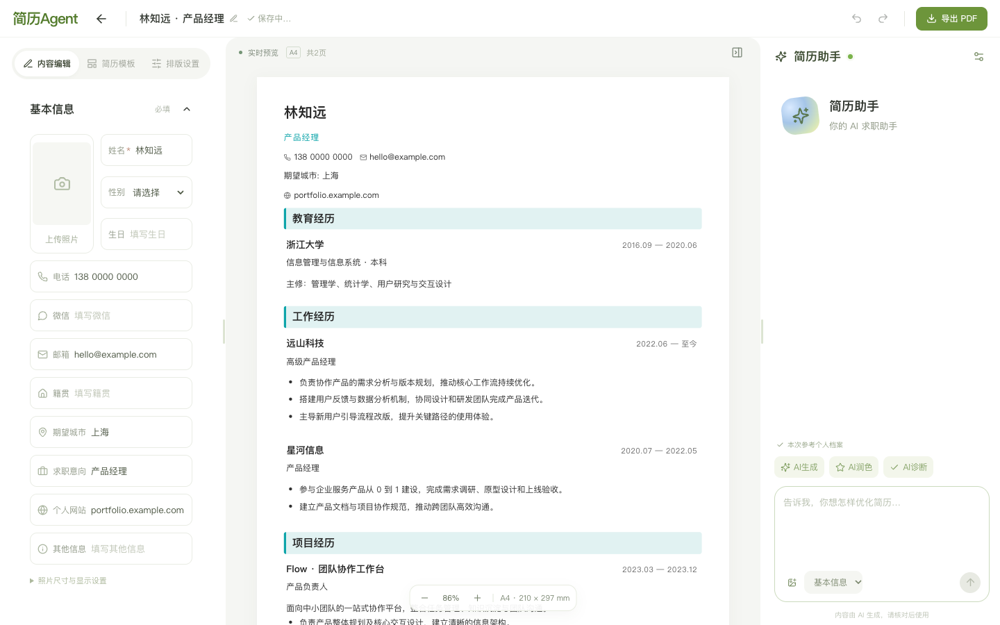

<div align="center">
  
  <h1>Resume Agent</h1>
  <p>An open-source resume editor with AI editing, live layout, and PDF export.</p>
  <p><a href="README.md">简体中文</a> · <a href="docs/guide.en.md">User guide</a></p>
</div>



## Start

Use Node.js 24.9 or later. From the project directory, run:

```sh
npm ci
npm run dev
```

Open [localhost:4173](http://localhost:4173).

## Configure an API key

In **Agent settings → Model and API**, select DeepSeek, Qwen, Zhipu, Kimi, or a custom compatible API. Enter the provider's API key, check the model and endpoint, and select **Save and test a response**.

**DeepSeek Harness requires no separate installation.** The repository includes the integration, and `npm ci` installs the Harness SDK and its dependencies. The app starts Harness for DeepSeek requests. Other providers use compatible APIs directly.

## Skills

The app uses **one project skill** at runtime.

| Skill | Path | Rules and invocation |
| --- | --- | --- |
| Resume editing | [server/skills/resume-editor/SKILL.md](server/skills/resume-editor/SKILL.md) | Markdown rules cover factual accuracy, rewriting, selection scope, and output. [server/prompts.js](server/prompts.js) includes the rules in prompts for both the home agent and the editor assistant. |

PDF import uses a separate classification prompt in [server/import-resume.js](server/import-resume.js).

[User and deployment guide](docs/guide.en.md) · [More screenshots](docs/screenshots) · [MIT license](LICENSE)
