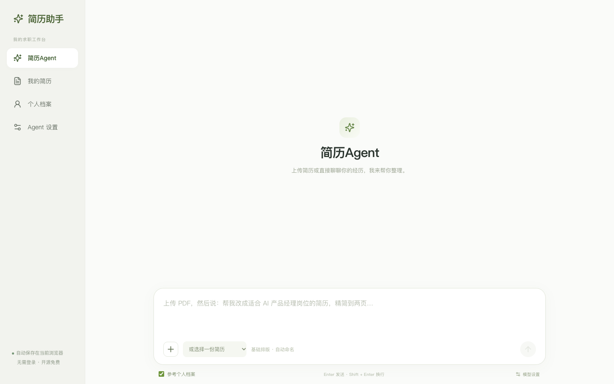
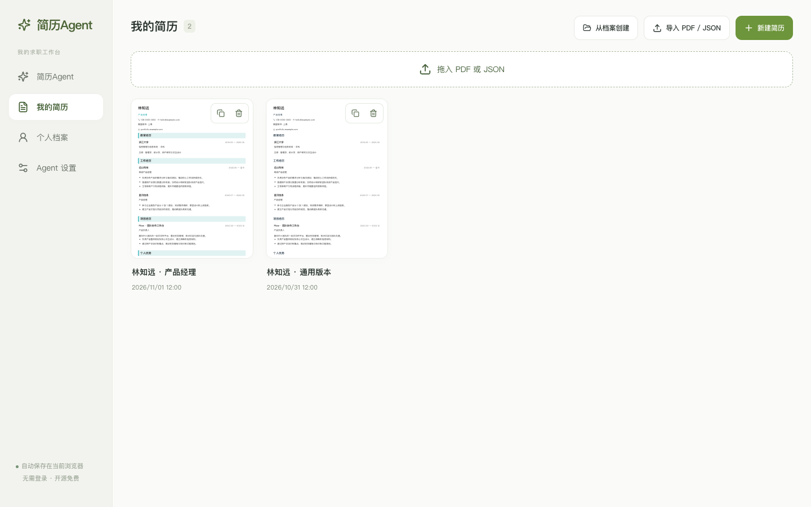
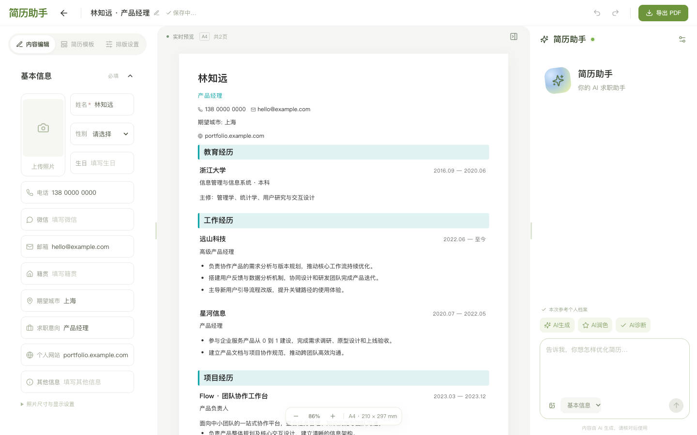
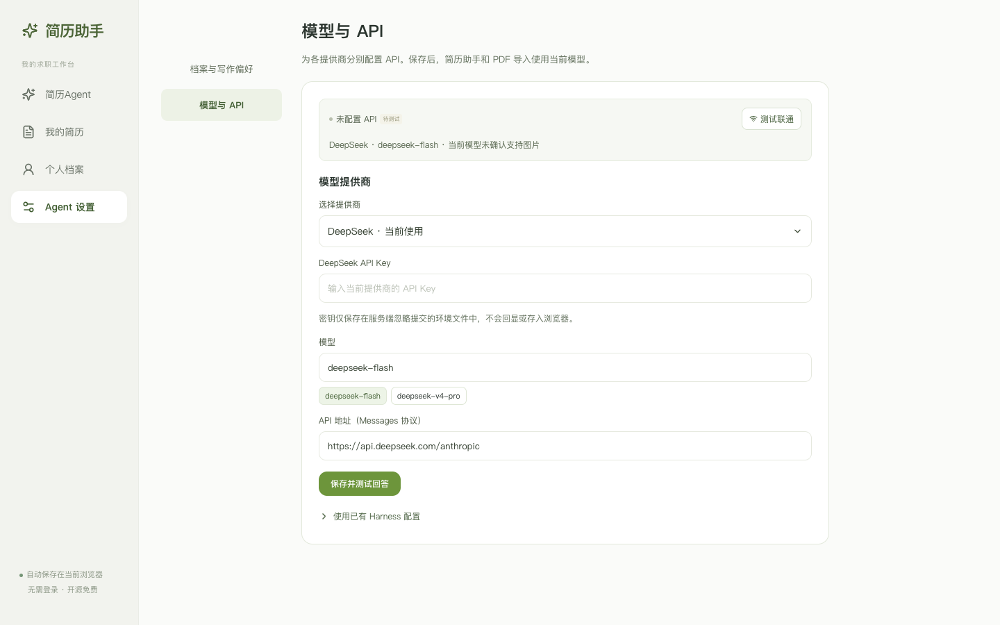

<div align="center">
  
  <h1>简历助手 · Resume Studio</h1>
  <p>浏览器里的开源简历工作台，支持直接编辑、AI 整理和 A4 PDF 导出。</p>
  <p>简体中文 · <a href="README.en.md">English</a></p>
</div>

## 项目截图

以下截图在全新的浏览器会话中生成，使用虚构示例资料。

| 简历 Agent | 我的简历 |
| --- | --- |
|  |  |
| **三栏编辑器** | **模型与 API 设置** |
|  |  |

## 功能

- **管理多份简历**。新建、复制、改名和删除，方便为不同岗位保留独立版本。
- **直接编辑 A4 预览**。左侧管理模块，中央编辑纸面内容，右侧可选中模块或条目让 AI 修改。AI 修改会直接应用，可继续追问、重新生成或撤回。
- **导入 PDF 或 JSON**。PDF 先提取文字和可识别的内嵌照片，再由配置的模型归类。确认前可以对照原文。JSON 备份直接读取。扫描件需先 OCR。
- **模板与 PDF 导出**。十套模板共用分页组件，可调字号、行距、页边距、模块间距与照片尺寸。
- **个人档案**。保存真实经历和求职偏好，可选择是否提供给模型。档案、简历和界面偏好保存在当前浏览器。

## 本地运行

需要 Node.js **24.9+**、npm 和 Chromium。安装浏览器供 PDF 导出使用。

```sh
git clone https://github.com/yyz666ai/resume-studio.git
cd resume-studio
npm ci
npx playwright install chromium
npm run dev
```

打开 [http://localhost:4173](http://localhost:4173)。macOS 上可使用已安装的 Chrome，也可以用 `CHROME_PATH` 指定浏览器。Linux 如缺少系统库，可运行 `npx playwright install --with-deps chromium`。

```sh
npm test
npm run build
npm start
```

| 服务端环境变量 | 用途 |
| --- | --- |
| `HOST` | 默认 `127.0.0.1`。在容器中可设为 `0.0.0.0`。 |
| `PORT` | 默认 `4173`。 |
| `CHROME_PATH` | 可选，自定义 Chrome 或 Chromium 可执行文件。 |
| `RESUME_CONFIG_FILE` | 可选，模型配置文件路径，默认项目根目录的 `.env.harness`。 |
| `DSH_HOME` | 可选，复用已有 DeepSeek Harness 时的配置目录。 |

项目也提供 [Dockerfile](Dockerfile)。应用没有账号认证。部署到远程服务器时，请通过私网或带身份验证的反向代理访问，尤其是保存了模型密钥的实例。

## 配置模型

打开 **Agent 设置 → 模型与 API**，选择提供商，填写该提供商的 API Key，核对模型 ID 和地址，然后点击 **保存并测试回答**。各提供商分别保存配置，切回已配置的提供商时，密钥栏留空即可复用。简历 Agent、编辑器助手和 PDF 智能导入都使用当前保存的模型。

| 提供商 | 默认模型 | 默认 API 地址 |
| --- | --- | --- |
| DeepSeek | `deepseek-flash` | `https://api.deepseek.com/anthropic`（通过 DeepSeek Harness 使用 Messages 协议） |
| 千问 | `qwen-plus` | `https://dashscope.aliyuncs.com/compatible-mode/v1` |
| 智谱 | `glm-4.7` | `https://open.bigmodel.cn/api/paas/v4` |
| Kimi | `kimi-k2.5` | `https://api.moonshot.cn/v1` |
| 自定义 | 自行填写 | OpenAI 兼容 Chat Completions 地址 |

地址、模型 ID 和区域应与密钥匹配。是否可用以联通测试为准。编辑、排版和 PDF 导出无需模型密钥，AI 功能可能产生提供商用量费用。DeepSeek 的 Harness 集成固定使用 `@deepseek-ai/dsh-sdk-client@0.2.2-alpha.2`，其余提供商通过兼容的 Chat Completions 接口调用。

### 英文输出

在 **Agent 设置 → 档案与写作偏好 → 界面语言** 选择 **English**。后续 AI 对话和修改请求会加上「用英文输出」，回答和新写的简历文案使用英文。切换语言不会改动已保存内容，PDF 导入也会保留原文语言。要翻译已有简历，可选中全文并要求改成英文。

### 密钥与个人资料

GitHub 中包含 DeepSeek 的**集成代码**，API Key 由每位使用者自行配置。默认密钥文件 `.env.harness` 由服务端保存，文件权限为 `0600`，Git 忽略该文件。浏览器不会收到已保存的密钥。个人简历、上传文件和本地 Harness 数据均未随项目发布。使用 AI 时，相关简历文字和请求会发送给当前配置的模型提供商。启用档案参考时，也会发送所需档案内容。

## 项目结构与测试

- `src/` 包含 React 界面、文档模型、模板和共享预览。
- `server/` 提供 Express 服务、PDF 导入导出和模型调用。
- `server/skills/resume-editor/SKILL.md` 定义简历编辑提示词。
- `tests/` 包含单元测试和浏览器流程检查。启动本地服务后可运行 `node tests/portal.mjs`、`node tests/home-agent.mjs` 或 `node tests/template-exports.mjs`。浏览器脚本默认使用 macOS Chrome，使用其他环境时请查阅对应脚本的浏览器配置。

欢迎通过 Issue 报告问题或提交 PR。反馈时请使用虚构简历，勿附真实密钥或个人资料。

## 许可证

[MIT](LICENSE)。
